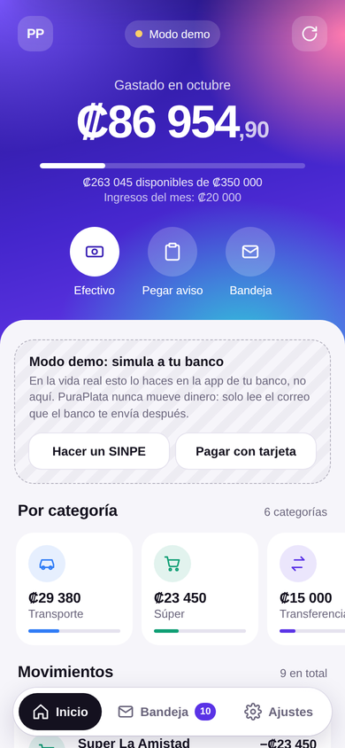
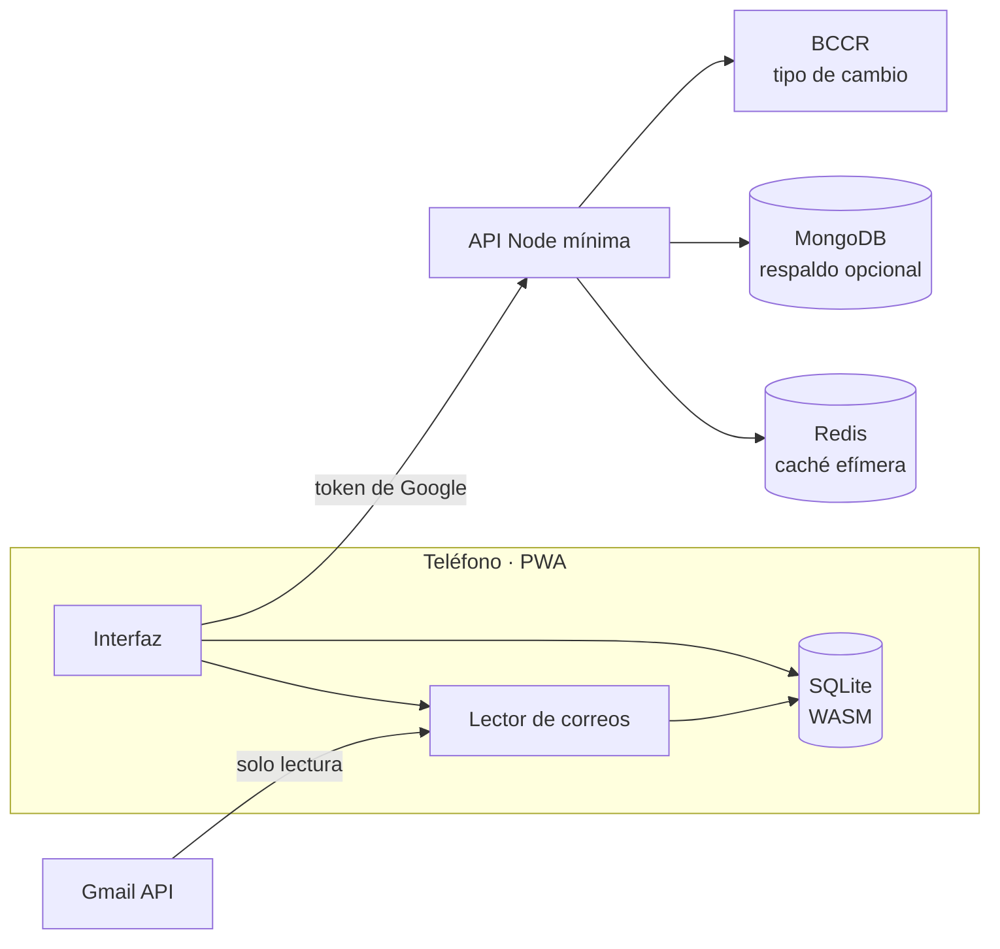
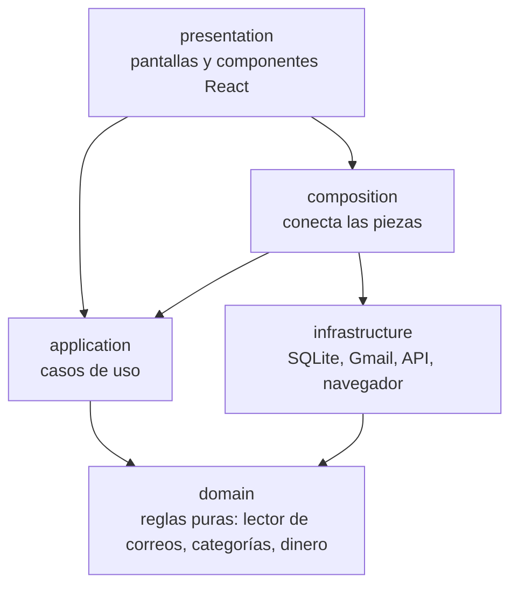
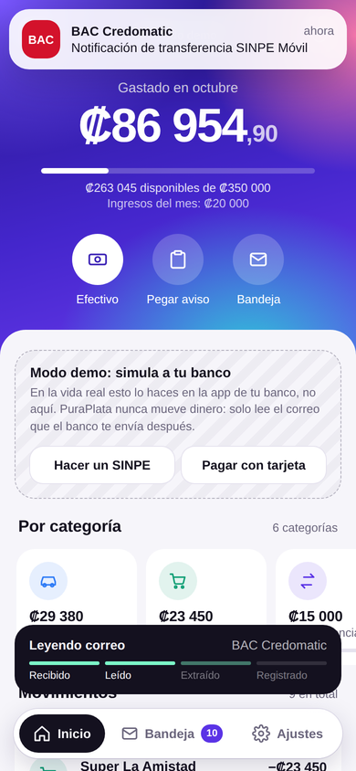

# Movo

> *Movo* = *money* + *movimiento*.

Gastos personales para Costa Rica que se registran solos. Movo lee las notificaciones que tus bancos ya te envían por correo (compras con tarjeta, SINPE Móvil enviados y recibidos), extrae monto, comercio y fecha, y las ordena por categoría. Es una PWA hecha con React: se instala en el teléfono desde el navegador, funciona sin conexión y todo el procesamiento ocurre en el propio teléfono.

Proyecto final del curso Tópicos Avanzados de Bases de Datos, Universidad Nacional (Grupo 1).



## El problema

Registrar gastos a mano se abandona en pocas semanas. La información ya existe: cada compra o SINPE genera un correo del banco, pero queda dispersa en la bandeja de entrada. Movo convierte esos correos en movimientos sin que la persona teclee nada.

Usuarios: personas en Costa Rica que pagan con tarjeta y SINPE Móvil, con cuentas en uno o varios bancos.

## Cómo funciona

1. Haces una compra o un SINPE como siempre, en la app de tu banco.
2. El banco te envía el correo de notificación.
3. Al abrir Movo, el teléfono consulta Gmail con permiso de solo lectura, lee los correos nuevos de remitentes bancarios y los convierte en movimientos.
4. Ves el gasto del mes, el presupuesto y el detalle por categoría. Si corriges una categoría, se guarda como regla.

Los SINPE recibidos cuentan como ingreso, las compras negadas por el banco no se registran, y los SINPE entre tus propias cuentas (mismo titular en origen y destino) no cuentan ni como gasto ni como ingreso.

El servidor nunca recibe tus correos ni lee tu Gmail. Solo hace tres cosas: entrega la configuración, sirve el tipo de cambio del BCCR y, si lo activas, guarda un respaldo de tus movimientos ya extraídos.

## Arquitectura



| Motor | Dónde | Qué guarda | Por qué |
|---|---|---|---|
| SQLite (sql.js) | En el teléfono, una base por usuario | Movimientos, correos leídos, reglas, ajustes | Funciona sin Internet y hace las agregaciones del mes con SQL real, sin cargar al servidor |
| Redis | Servidor | Validación de tokens (TTL), límite de solicitudes, tipo de cambio (6 h) | Datos efímeros: si se pierden, se reconstruyen |
| MongoDB | Servidor | Respaldo por usuario: movimientos, reglas y ajustes | Esquema flexible por banco; sincroniza varios teléfonos |

### Capas del código

El código del teléfono (`web/src`) está separado en capas. Cada capa solo conoce a las de abajo:



| Carpeta | Qué contiene | Ejemplo |
|---|---|---|
| `domain` | Reglas del negocio, sin base de datos ni pantalla | `emailParser/` lee un correo del banco |
| `application` | Lo que la app puede hacer (casos de uso) | `ingestMail.js` registra los movimientos de un correo |
| `infrastructure` | Conexión con el mundo exterior | `sqlite/`, `gmail/`, `backend/` |
| `presentation` | React: pantallas, ventanas y estilos | `screens/HomeScreen.jsx` |
| `composition` | Arma las capas entre sí | `openSession.js` |

El servidor (`server/src`) tiene el mismo orden: `domain`, `application` y `adapters` (HTTP, MongoDB, Redis, BCCR, Google). La app y el servidor solo comparten el contrato de [`shared/`](shared/backupContract.js).

Detalles, decisiones y escenarios de falla: [docs/ARQUITECTURA.md](docs/ARQUITECTURA.md). API: [docs/API.md](docs/API.md). Guía para colaborar: [docs/CONTRIBUIR.md](docs/CONTRIBUIR.md).

## Probar en local

Requisitos: Node 20 o superior.

```bash
npm install
npm install --prefix server
npm run dev          # la app en http://localhost:5173 (modo demo, sin servidor)
```

Para probar también la API (tipo de cambio y respaldo), en otra terminal:

```bash
npm run dev --prefix server    # API en http://localhost:3000; la app la usa sola
```

Para ver la versión compilada, tal como se publica: `npm start` (compila con Vite y la sirve desde la API en http://localhost:3000).

Sin `GOOGLE_CLIENT_ID` la app abre en modo demo. Para probar con tu Gmail en local, define `GOOGLE_CLIENT_ID` y registra `http://localhost:5173` como origen y `http://localhost:5173/` como URI de redirección en Google Cloud.

## Publicar en un VPS e instalar en el teléfono

Resumen (paso a paso en [docs/DESPLIEGUE.md](docs/DESPLIEGUE.md)):

```bash
git clone https://github.com/jbrown230/Movo.git && cd Movo
cp .env.example .env      # DOMAIN y GOOGLE_CLIENT_ID
docker compose up -d --build
curl https://TU_DOMINIO/api/health
```

En Android abre el dominio en Chrome y toca "Instalar app". En iPhone, en Safari: Compartir y "Agregar a pantalla de inicio".

## Modo demo

En la pantalla de bienvenida, "Ver el modo demo" carga datos de ejemplo en una base separada y muestra un simulador del banco: haces un SINPE o una compra, llega la notificación y Movo la registra sola. Los correos del modo demo son sintéticos.



## Pruebas y mediciones

```bash
npm test             # lector, SQLite local, casos de uso, interfaz React, contrato, arquitectura, API, Redis y MongoDB*
npm run check        # lint, formato, pruebas y compilación (lo mismo que corre el CI)
npm run bench        # precisión del lector y tiempos de SQLite con 2000 correos sintéticos
npm run dataset -- 50 > correos.json   # dataset sintético reproducible
```

\* Las pruebas de Redis y MongoDB reales se ejecutan cuando existen `REDIS_URL` y `MONGO_URL` (GitHub Actions las levanta como servicios).

Resultado de referencia del benchmark (2000 correos, semilla fija): precisión 100 % en monto, comercio, fecha, tipo y dirección; ingesta en SQLite de unos 0,5 ms por correo; resumen del mes en menos de 1 ms. Los correos del BCR del benchmark siguen la estructura real; los de BAC y BN son sintéticos. Las pruebas en `tests/fixtures/bcr-html/` usan la estructura exacta de notificaciones reales del BCR (descargadas con "Mostrar original" en Gmail), con **todos** los datos personales reemplazados por valores ficticios. Para agregar un banco nuevo se sigue el mismo camino: descargar el .eml, anonimizarlo y escribir la plantilla con su prueba (paso a paso en [docs/CONTRIBUIR.md](docs/CONTRIBUIR.md)). Una prueba automática (`tests/privacy`) revisa que no se cuele ningún correo, teléfono, tarjeta, referencia, secreto ni nombre real.

## Privacidad

Permiso de Gmail de solo lectura y búsqueda limitada a remitentes bancarios. Los correos se procesan y guardan solo en el teléfono. El respaldo es opcional y contiene únicamente datos extraídos. Cada consulta al servidor se filtra por el identificador de Google del usuario. Desde Ajustes puedes borrar tus datos del teléfono y del servidor.

Este repositorio no contiene datos reales: los correos de ejemplo, el modo demo y las pruebas usan nombres, teléfonos, referencias y tarjetas inventados.

## Limitaciones conocidas

- Bancos soportados con formato real: **BCR** (SINPE Móvil enviado y recibido, y la tabla de transacciones con tarjeta, incluido el estado "Negada"). BAC y BN usan por ahora formatos sintéticos en la demo; para los demás bancos hace falta una plantilla oficial: sin ella el correo se ignora, para no leer publicidad como gasto. Lo que no se reconoce queda como "Sin movimiento" y se puede registrar a mano. Cuando el lector mejora, la app vuelve a leer sola esos correos.
- Con la app de Google en modo "Prueba", solo pueden entrar hasta 100 cuentas invitadas, y Google muestra la advertencia de app no verificada.
- La lectura ocurre al abrir la app (el token de Google dura una hora). No hay lectura en segundo plano.
- En iPhone, el inicio de sesión dentro de la PWA instalada puede abrirse en una ventana aparte; en Android funciona dentro de la app.

## Roadmap

En 1 mes: plantillas reales de BAC, BN, Davivienda y Promerica (BCR ya está; ver [docs/BACKLOG.md](docs/BACKLOG.md)); alertas de presupuesto; exportar CSV. En 6 meses: lectura en segundo plano con Periodic Background Sync, Outlook vía Microsoft Graph, metas de ahorro. Como TFG: comparar parsers por reglas frente a un modelo de lenguaje para extraer y clasificar transacciones de correos bancarios costarricenses, y detección de cargos anómalos.

## Equipo

Dylan Mejía Ruiz, Jose Meza Álvarez, Jordy Palacios Brown y Yader Barahona Villarreal.

## Licencia

MIT. Ver [LICENSE](LICENSE). Incluye sql.js (MIT) en `web/vendor/`.
