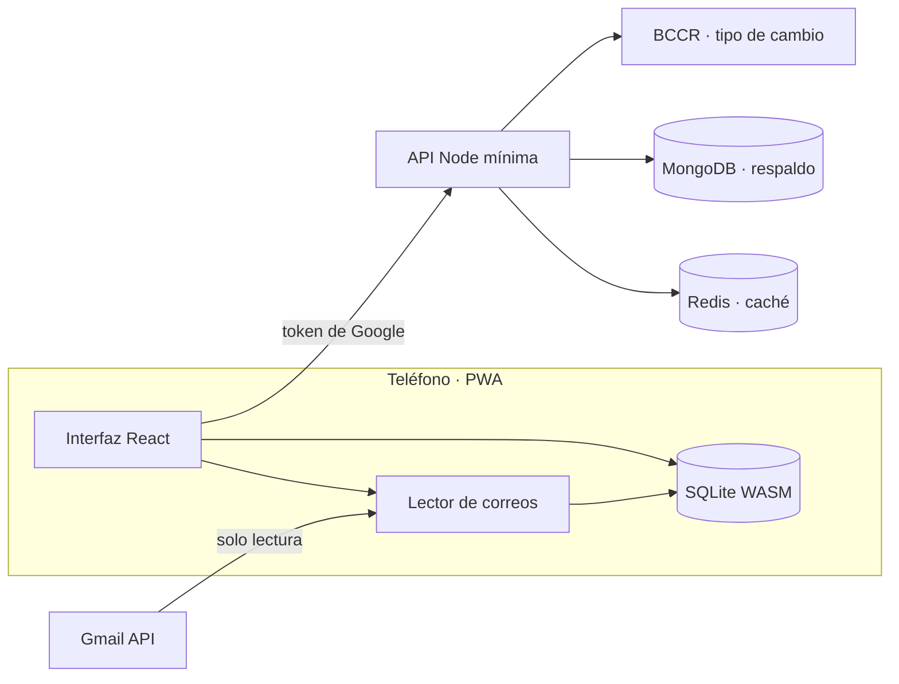
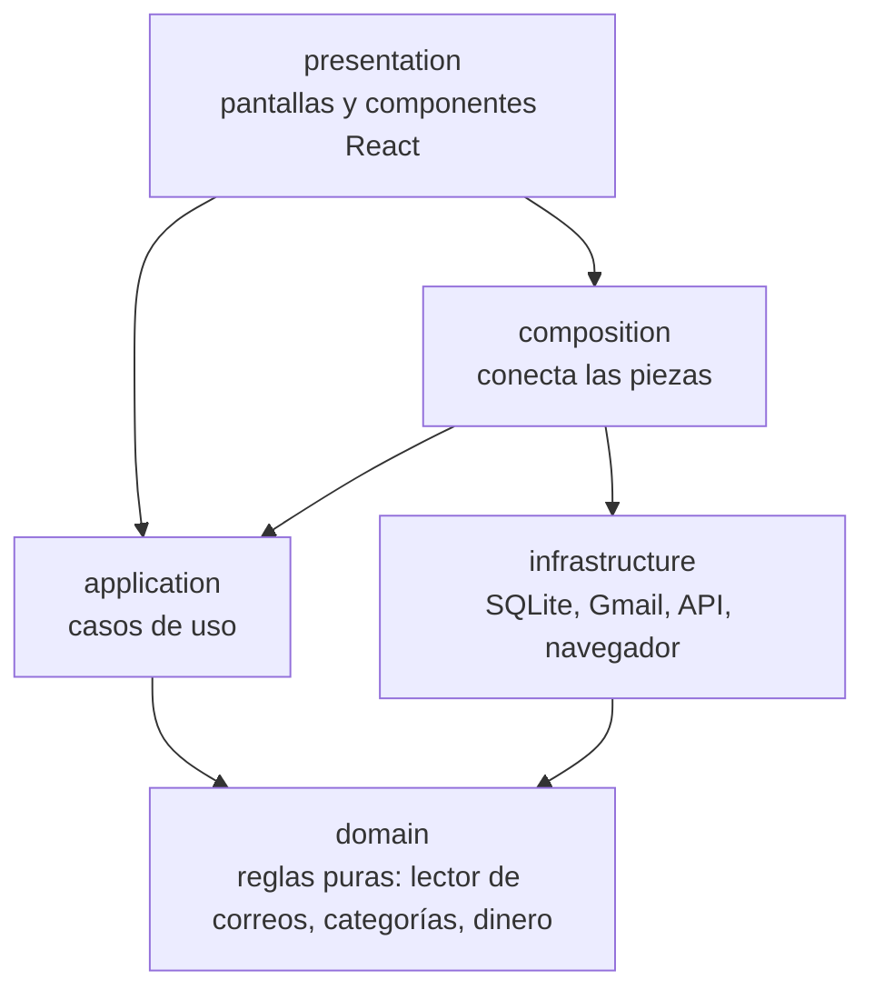

# Análisis del Proyecto Movo

> **Movo** = *money* + *movimiento* — PWA de gastos personales para Costa Rica.

## Resumen Ejecutivo

Movo es una **Progressive Web App** que automatiza el registro de gastos leyendo las notificaciones bancarias que llegan por correo (Gmail). Está diseñada para usuarios en Costa Rica que pagan con tarjeta y SINPE Móvil. El procesamiento ocurre **enteramente en el teléfono**; el servidor es mínimo y opcional.

Proyecto final del curso **Tópicos Avanzados de Bases de Datos**, Universidad Nacional (Grupo 1).

---

## Stack Tecnológico

| Capa | Tecnología | Detalle |
|------|-----------|---------|
| **Frontend** | React 18 + Vite 5 | PWA instalable, service worker, modo offline |
| **Base local** | SQLite vía sql.js (WASM) | Una base por usuario, en el navegador |
| **Backend** | Node.js + Express 4 | API mínima: config, tipo de cambio, respaldo |
| **Caché** | Redis 7 | Tokens, rate limiting, tipo de cambio (TTL) |
| **Persistencia** | MongoDB 7 | Respaldo opcional por usuario |
| **Email** | Gmail API (solo lectura) | Lectura desde el teléfono, nunca pasa por el servidor |
| **Deploy** | Docker Compose + Caddy | HTTPS automático, multi-contenedor |
| **CI** | GitHub Actions | Lint, formato, pruebas, build |
| **Calidad** | ESLint 9 + Prettier | Reglas de legibilidad estrictas |
| **Testing** | Node test runner + Vitest | Pruebas unitarias, de UI, de contrato y de arquitectura |

---

## Arquitectura

### Diagrama General



### Capas del Frontend ([`web/src/`](file:///c:/Users/jose/Documents/GitHub/Movo/web/src))



| Carpeta | Contenido | Archivos clave |
|---------|-----------|----------------|
| [`domain/`](file:///c:/Users/jose/Documents/GitHub/Movo/web/src/domain) | Reglas de negocio puras, sin I/O | [`emailParser/`](file:///c:/Users/jose/Documents/GitHub/Movo/web/src/domain/emailParser), [`categories.js`](file:///c:/Users/jose/Documents/GitHub/Movo/web/src/domain/categories.js), [`money.js`](file:///c:/Users/jose/Documents/GitHub/Movo/web/src/domain/money.js), [`types.js`](file:///c:/Users/jose/Documents/GitHub/Movo/web/src/domain/types.js) |
| [`application/`](file:///c:/Users/jose/Documents/GitHub/Movo/web/src/application) | Casos de uso (12 módulos) | [`ingestMail.js`](file:///c:/Users/jose/Documents/GitHub/Movo/web/src/application/ingestMail.js), [`scanInbox.js`](file:///c:/Users/jose/Documents/GitHub/Movo/web/src/application/scanInbox.js), [`backupSync.js`](file:///c:/Users/jose/Documents/GitHub/Movo/web/src/application/backupSync.js), [`reparseMails.js`](file:///c:/Users/jose/Documents/GitHub/Movo/web/src/application/reparseMails.js) |
| [`infrastructure/`](file:///c:/Users/jose/Documents/GitHub/Movo/web/src/infrastructure) | Adaptadores a servicios externos | [`sqlite/`](file:///c:/Users/jose/Documents/GitHub/Movo/web/src/infrastructure/sqlite) (9 archivos), [`gmail/`](file:///c:/Users/jose/Documents/GitHub/Movo/web/src/infrastructure/gmail), [`backend/`](file:///c:/Users/jose/Documents/GitHub/Movo/web/src/infrastructure/backend) |
| [`presentation/`](file:///c:/Users/jose/Documents/GitHub/Movo/web/src/presentation) | UI React | [`screens/`](file:///c:/Users/jose/Documents/GitHub/Movo/web/src/presentation/screens) (5), [`modals/`](file:///c:/Users/jose/Documents/GitHub/Movo/web/src/presentation/modals) (5), [`components/`](file:///c:/Users/jose/Documents/GitHub/Movo/web/src/presentation/components) (4) |
| [`composition/`](file:///c:/Users/jose/Documents/GitHub/Movo/web/src/composition) | Wiring / inyección de dependencias | [`openSession.js`](file:///c:/Users/jose/Documents/GitHub/Movo/web/src/composition/openSession.js), [`platform.js`](file:///c:/Users/jose/Documents/GitHub/Movo/web/src/composition/platform.js) |
| [`demo/`](file:///c:/Users/jose/Documents/GitHub/Movo/web/src/demo) | Modo demo con simulador de banco | [`mailBuilder.js`](file:///c:/Users/jose/Documents/GitHub/Movo/web/src/demo/mailBuilder.js), [`seedMails.js`](file:///c:/Users/jose/Documents/GitHub/Movo/web/src/demo/seedMails.js) |

### Capas del Backend ([`server/src/`](file:///c:/Users/jose/Documents/GitHub/Movo/server/src))

| Carpeta | Contenido | Archivos clave |
|---------|-----------|----------------|
| [`domain/`](file:///c:/Users/jose/Documents/GitHub/Movo/server/src/domain) | Reglas de dominio del servidor | [`backupRecord.js`](file:///c:/Users/jose/Documents/GitHub/Movo/server/src/domain/backupRecord.js) |
| [`application/`](file:///c:/Users/jose/Documents/GitHub/Movo/server/src/application) | Casos de uso (10 módulos) | [`authenticateUser.js`](file:///c:/Users/jose/Documents/GitHub/Movo/server/src/application/authenticateUser.js), [`syncBackup.js`](file:///c:/Users/jose/Documents/GitHub/Movo/server/src/application/syncBackup.js), [`getExchangeRate.js`](file:///c:/Users/jose/Documents/GitHub/Movo/server/src/application/getExchangeRate.js) |
| [`adapters/`](file:///c:/Users/jose/Documents/GitHub/Movo/server/src/adapters) | Adaptadores HTTP, MongoDB, Redis, BCCR, Google | [`http/`](file:///c:/Users/jose/Documents/GitHub/Movo/server/src/adapters/http), [`mongo/`](file:///c:/Users/jose/Documents/GitHub/Movo/server/src/adapters/mongo), [`bccr/`](file:///c:/Users/jose/Documents/GitHub/Movo/server/src/adapters/bccr) |

### Contrato Compartido ([`shared/`](file:///c:/Users/jose/Documents/GitHub/Movo/shared))

Un único archivo [`backupContract.js`](file:///c:/Users/jose/Documents/GitHub/Movo/shared/backupContract.js) define los tipos, constantes y límites del protocolo de sincronización. Lo importan tanto el frontend como el backend, garantizando coherencia.

---

## Lector de Correos Bancarios

Motor central del proyecto — extrae movimientos de correos bancarios:

| Plantilla | Archivo | Estado |
|-----------|---------|--------|
| BCR — SINPE Móvil | [`bcrSinpe.js`](file:///c:/Users/jose/Documents/GitHub/Movo/web/src/domain/emailParser/templates/bcrSinpe.js) | ✅ Formato real |
| BCR — Tarjeta (tabla de transacciones) | [`bcrCard.js`](file:///c:/Users/jose/Documents/GitHub/Movo/web/src/domain/emailParser/templates/bcrCard.js) | ✅ Formato real |
| BN — Voucher Digital (compra con tarjeta) | [`bnVoucher.js`](file:///c:/Users/jose/Documents/GitHub/Movo/web/src/domain/emailParser/templates/bnVoucher.js) | ✅ Formato real |
| BAC + SINPE BN | [`syntheticBanks.js`](file:///c:/Users/jose/Documents/GitHub/Movo/web/src/domain/emailParser/templates/syntheticBanks.js) | ⚠️ Sintético |

Utilidades de parsing: [`amount.js`](file:///c:/Users/jose/Documents/GitHub/Movo/web/src/domain/emailParser/amount.js), [`currency.js`](file:///c:/Users/jose/Documents/GitHub/Movo/web/src/domain/emailParser/currency.js), [`dateTime.js`](file:///c:/Users/jose/Documents/GitHub/Movo/web/src/domain/emailParser/dateTime.js), [`text.js`](file:///c:/Users/jose/Documents/GitHub/Movo/web/src/domain/emailParser/text.js).

---

## Base de Datos (3 motores)

| Motor | Ubicación | Uso |
|-------|-----------|-----|
| **SQLite (sql.js WASM)** | Navegador, una BD por usuario | Movimientos, correos leídos, reglas, ajustes. Funciona sin Internet. |
| **Redis** | Servidor | Caché efímera: tokens (TTL), rate limiting, tipo de cambio (6h). Config: sin persistencia, 64 MB, LRU. |
| **MongoDB** | Servidor | Respaldo opcional por usuario. Esquema flexible. |

SQLite cuenta con 9 archivos de infraestructura: repositorios, migraciones, key-value stores, y un executor SQL.

---

## Pruebas

Estructura de tests en [`tests/`](file:///c:/Users/jose/Documents/GitHub/Movo/tests):

| Carpeta | Qué prueba |
|---------|-----------|
| `domain/` | Reglas puras (parser, categorías, dinero) |
| `application/` | Casos de uso |
| `infrastructure/` | SQLite, Gmail mock, backend |
| `presentation/` | Componentes React (Vitest + Testing Library) |
| `contract/` | Sincronización teléfono ↔ servidor |
| `architecture/` | Que las capas no se salten el orden |
| `privacy/` | Que no se cuelen datos reales en fixtures |
| `fixtures/` | Correos HTML reales anonimizados del BCR |
| `helpers/` | Utilidades para los tests |

Scripts adicionales:
- `npm run bench` — Benchmark: 2000 correos, precisión y tiempos
- `npm run dataset` — Dataset sintético reproducible

---

## CI/CD y Calidad

- **GitHub Actions** ([`ci.yml`](file:///c:/Users/jose/Documents/GitHub/Movo/.github/workflows/ci.yml)): lint, formato, tests, build
- **ESLint** con reglas estrictas de legibilidad: `max-lines-per-function: 70`, `complexity: 12`, `max-depth: 4`, `id-length: min 2`
- **Prettier** para formato consistente
- **Docker Compose** para deploy con Caddy (HTTPS), API, Redis y MongoDB
- **CSP** (Content Security Policy) inyectada automáticamente en el build de producción

---

## Documentación

| Archivo | Contenido |
|---------|-----------|
| [`README.md`](file:///c:/Users/jose/Documents/GitHub/Movo/README.md) | Descripción general, arquitectura, setup, modo demo |
| [`docs/ARQUITECTURA.md`](file:///c:/Users/jose/Documents/GitHub/Movo/docs/ARQUITECTURA.md) | Modelo de datos, decisiones, escenarios de falla |
| [`docs/API.md`](file:///c:/Users/jose/Documents/GitHub/Movo/docs/API.md) | Documentación de la API REST |
| [`docs/CONTRIBUIR.md`](file:///c:/Users/jose/Documents/GitHub/Movo/docs/CONTRIBUIR.md) | Guía para colaboradores |
| [`docs/DESPLIEGUE.md`](file:///c:/Users/jose/Documents/GitHub/Movo/docs/DESPLIEGUE.md) | Deploy paso a paso en VPS |
| [`docs/BACKLOG.md`](file:///c:/Users/jose/Documents/GitHub/Movo/docs/BACKLOG.md) | Tareas pendientes por integrante |
| [`CHANGELOG.md`](file:///c:/Users/jose/Documents/GitHub/Movo/CHANGELOG.md) | Historial de cambios (v0.1.0) |

---

## Evaluación General

### ✅ Fortalezas

| Aspecto | Detalle |
|---------|---------|
| **Arquitectura limpia** | Separación rigurosa en capas (domain → application → infrastructure → presentation). Pruebas de arquitectura que fallan si se violan dependencias. |
| **Privacidad por diseño** | Los correos nunca salen del teléfono. Pruebas automáticas de que no se filtren datos reales. |
| **Offline-first** | SQLite en WASM + Service Worker. Funciona sin servidor. |
| **Contrato compartido** | Un solo archivo como fuente de verdad para la sincronización. |
| **Calidad de código** | ESLint estricto (funciones cortas, baja complejidad, nombres descriptivos), Prettier, CI que ejecuta todo. |
| **Documentación completa** | README, arquitectura, API, contribución, despliegue, backlog, changelog — todo en español y bien redactado. |
| **Modo demo** | Simulador del banco incluido; permite probar sin cuenta Gmail. |
| **Testing exhaustivo** | Pruebas por capa, de contrato, de arquitectura, de privacidad, benchmark reproducible. |

### ⚠️ Áreas de mejora / Limitaciones

| Aspecto | Detalle |
|---------|---------|
| **Bancos soportados** | Solo BCR y BN tienen formato real. BAC, Davivienda, Promerica pendientes. |
| **React 18** | No usa la última versión de React (19). No es urgente, pero conviene planificar la migración. |
| **Sin TypeScript** | Todo el proyecto es JS puro con JSDoc. Para un proyecto de este tamaño funciona, pero TypeScript daría más seguridad. |
| **Sin lectura en segundo plano** | La app solo lee correos al abrirse (token de 1 hora). Pendiente: Periodic Background Sync. |
| **Google "modo prueba"** | Limitado a 100 cuentas mientras no se verifique la app. |
| **PWA en iOS** | El login puede abrir ventana aparte en iPhone. |

---

## Estructura de archivos resumida

```
Movo/
├── web/                      # PWA (React + Vite)
│   ├── src/
│   │   ├── domain/           # Reglas puras (parser, categorías, dinero)
│   │   ├── application/      # 12 casos de uso
│   │   ├── infrastructure/   # SQLite, Gmail, backend, browser
│   │   ├── presentation/     # App, screens (5), modals (5), components (4)
│   │   ├── composition/      # Wiring / inyección de dependencias
│   │   └── demo/             # Modo demo + simulador
│   └── public/               # Assets estáticos + sw.js
├── server/                   # API Node (Express)
│   └── src/
│       ├── domain/           # backupRecord
│       ├── application/      # 10 casos de uso
│       └── adapters/         # HTTP, MongoDB, Redis, BCCR, Google
├── shared/                   # backupContract.js (contrato único)
├── tests/                    # 9 carpetas de pruebas
├── scripts/                  # Benchmark, dataset, issues, iconos
├── docs/                     # Arquitectura, API, deploy, contribuir, backlog
├── deploy/                   # Nginx config, script de actualización
├── docker-compose.yml        # Caddy + API + Redis + MongoDB
├── Dockerfile                # Build multi-etapa (Vite → Caddy)
└── vite.config.js            # Config con proxy y CSP
```

> [!TIP]
> El proyecto está en **v0.1.0** y tiene una base sólida. Las prioridades del roadmap (más bancos, alertas de presupuesto, exportar CSV) son extensiones naturales de la arquitectura ya establecida.
